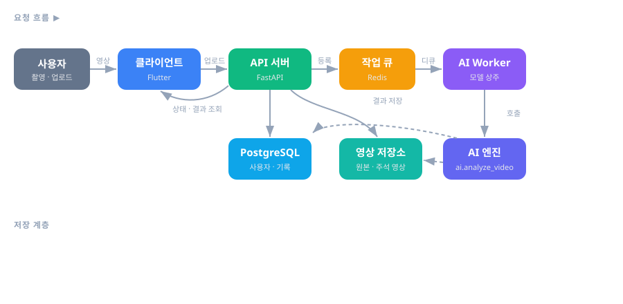
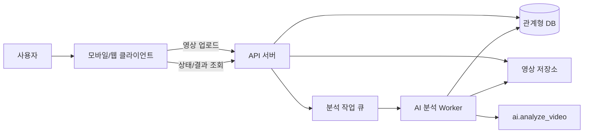

# 서비스 기획 문서 — 기술 스택과 아키텍처

> AI 알고리즘 자체의 원리(YOLO Pose, 각도 계산, 상태기계)는 [ARCHITECTURE.md](./ARCHITECTURE.md)에서 다룬다.


## 1. 제품 개요

| 항목 | 내용 |
| --- | --- |
| 한 줄 정의 | 운동 영상을 올리면 반복 횟수와 자세 교정 피드백을 자동으로 알려주는 AI 피트니스 앱 |
| 핵심 가치 | 트레이너 없이도 "내 자세가 맞는지" 즉시 확인 |
| 1차 타겟 운동 | 스쿼트 (측면 촬영 업로드 영상) |
| MVP 범위 | 영상 업로드 → 분석 → 결과(반복 수·피드백·주석 영상) → 운동 기록 저장 |
| MVP 제외 | 실시간 카메라 분석, 여러 명 동시 분석, 3D 자세 추정 |

현재 `ai/` 패키지에 인식(YOLO Pose)·측정(각도 계산)·판단(rep 카운트, 스쿼트 규칙) 로직이 이미 구현되어 있다. 이 문서가 다루는 것은 이 엔진을 감싸는 **서비스 계층**(앱, API, 저장소, 배포)이다.

## 2. 시스템 아키텍처



> 위 그림 한 장으로 전체 흐름을 볼 수 있다: **사용자 → 클라이언트 → API → 큐 → Worker → AI 엔진**으로 요청이 흐르고,
> API와 Worker가 **PostgreSQL·영상 저장소**를 공유한다. 실선은 요청 흐름, 점선은 분석 결과 저장이다.

<details>
<summary>같은 구조를 텍스트(Mermaid)로 보기</summary>



</details>

| 계층 | 책임 | 하지 않는 일 |
| --- | --- | --- |
| 클라이언트 | 촬영/업로드, 진행 상태 표시, 결과·기록 화면 | AI 추론, 판정 로직 |
| API 서버 | 인증, 업로드 검증, 작업 생성/조회, 기록 CRUD | 프레임 단위 분석 |
| AI Worker | 모델 로드, `ai.analyze_video()` 실행, 결과 저장 | HTTP/화면 로직 |
| 저장 계층 | 사용자·기록 메타데이터(DB), 원본/주석 영상(파일 저장소) | 비즈니스 판정 |

### 왜 분석을 별도 Worker로 분리하는가

영상 1개 분석은 수 초~수십 초가 걸린다. API 요청 스레드 안에서 바로 실행하면 다른 사용자의 로그인·조회 요청까지 함께 느려진다. 그래서 API는 업로드를 받으면 `job_id`만 즉시 반환하고, Worker가 백그라운드에서 분석한다.


## 3. 기술 스택

| 영역 | 기술 |
| --- | --- |
| 클라이언트 | Flutter |
| API 서버 | FastAPI (Python) |
| DB 접근 | SQLAlchemy + Alembic |
| DB | PostgreSQL |
| 비동기 작업 큐 | Redis + RQ (또는 Celery) |
| AI 추론 | Ultralytics YOLO11 Pose |
| 영상 처리 | OpenCV, NumPy |
| 배포 | Docker Compose → 단일 서버(NCP 등) |

`requirements.txt`의 Streamlit은 AI 로직을 빠르게 눈으로 확인하는 개발용 도구로만 남기고, 최종 사용자용 UI는 Flutter로 만든다.

## 4. 데이터 흐름 (엔드투엔드)

1. 사용자가 클라이언트에서 운동 종류를 고르고 영상을 선택한다.
2. 클라이언트가 `multipart/form-data`로 API에 업로드한다.
3. API가 인증, 파일 형식·용량, 운동 종류를 검증하고 영상을 저장소에 저장한다.
4. API가 `AnalysisJob`을 `QUEUED`로 생성하고 큐에 등록, `job_id`를 즉시 응답한다.
5. Worker가 작업을 꺼내 미리 로드해둔 `PoseDetector`로 `ai.analyze_video()`를 호출한다.
6. Worker가 `Report.to_dict()` 결과와 주석 영상 경로를 DB에 기록하고 상태를 `COMPLETED`(실패 시 `FAILED`)로 바꾼다.
7. 클라이언트는 `job_id`로 상태를 폴링하다가 완료되면 반복 수·피드백·주석 영상을 보여준다.

## 5. 데이터 모델 (초안)

| 모델 | 핵심 필드 | 용도 |
| --- | --- | --- |
| `User` | id, email, password_hash, nickname, created_at | 인증·소유권 |
| `AnalysisJob` | id, user_id, exercise_type, status, original_video_path, annotated_video_path, error_message, created_at | 비동기 작업 추적 |
| `WorkoutResult` | id, analysis_job_id, rep_count, camera_view, frames_processed, duration_seconds | 완료된 분석 결과 요약 |
| `RepVerdict` | id, workout_result_id, rep_index, verdict(correct/needs_work/incorrect) | rep별 종합 판정(초록/노랑/빨강) |
| `FormIssue` | id, workout_result_id, rep_index, code, severity, message, measured_value, threshold | rep별 자세 문제 상세 |

영상 바이너리는 DB에 넣지 않고 경로/URL만 저장한다. `camera_view`·`RepVerdict` 는 AI 엔진이
새로 내려주는 값이므로 스키마에 반영해 저장한다(`measured_value` ← 엔진 `measured`).

## 6. API 개요 (초안)

| Method | Endpoint | 설명 |
| --- | --- | --- |
| POST | `/api/v1/auth/signup` | 회원가입 |
| POST | `/api/v1/auth/login` | 로그인, 토큰 발급 |
| GET | `/api/v1/exercises` | 지원 운동 목록 |
| POST | `/api/v1/analyses` | 영상 업로드 + 분석 작업 생성 |
| GET | `/api/v1/analyses/{job_id}` | 작업 상태 조회 |
| GET | `/api/v1/analyses/{job_id}/result` | 결과 조회 |
| GET | `/api/v1/workouts` | 운동 기록 목록/캘린더 |
| DELETE | `/api/v1/analyses/{job_id}` | 기록·영상 삭제 |

```json
// POST /api/v1/analyses 응답
{ "job_id": "01J123ABC", "status": "queued", "exercise": "squat" }
```

```json
// GET /api/v1/analyses/{job_id}/result 응답
// 굵은 필드는 AI 엔진 Report.to_dict() 가 그대로 내려주는 값이다.
// (annotated_video_url·job_id·status 는 백엔드가 채운다)
{
  "job_id": "01J123ABC",
  "status": "completed",
  "rep_count": 10,
  "camera_view": "side",                 // 스쿼트는 측면 촬영만 받으므로 항상 "side"
  "verdict_counts": { "correct": 8, "needs_work": 1, "incorrect": 1 },
  "rep_verdicts": [
    { "rep_index": 3, "verdict": "needs_work", "label": "교정 필요" }
  ],
  "issues": [
    { "rep_index": 3, "code": "shallow_depth", "severity": "warning",
      "message": "더 깊게 앉으세요 (허벅지가 바닥과 수평이 되도록).", "measured": 118.2 }
  ],
  "annotated_video_url": "/media/analyses/01J123ABC.mp4"
}
```

> **엔진 계약 주의점**
> - `Report.to_dict()` 의 `annotated_video_path` 는 **서버 로컬 파일 경로**다. 백엔드가 정적
>   서빙 URL(`annotated_video_url`)로 변환해서 내려줘야 하며, 로컬 경로를 그대로 노출하지 않는다.
> - 각 결함의 값 필드 이름은 엔진에서는 `measured` 다(아래 DB의 `measured_value` 와 매핑).
>   같은 항목의 `threshold` 는 그 값을 발생시킨 기준선이며 `measured` 와 **같은 지표·단위**다.
>   임계값이 나중에 바뀌어도 과거 리포트를 그대로 해석할 수 있게 함께 저장한다.
> - 스쿼트는 **측면 촬영 전용**이라 깊이·상체숙임만 판정한다(`camera_view` 는 항상 `"side"`).
>   정면 전용 규칙(무릎모임·비대칭)은 정면 촬영을 도입할 때 추가한다.
> - 잘못된 입력에 대해 엔진은 `FileNotFoundError`/`RuntimeError` 를 던진다. Worker 가 잡아
>   작업 상태를 `FAILED` 로 바꾼다.

## 7. 디렉터리 구조 (목표)

```text
thepict/
├── ai/                          # ★ 분석 엔진 (구현 완료) — 서비스 계층과 독립된 순수 Python 모듈
│   ├── engine.py                #   공개 진입점: analyze_video(video, exercise) → Report
│   ├── cli.py                   #   터미널 단독 실행: py -m ai.cli 영상.mp4
│   ├── config.py                #   모델 경로·임계값 등 튜닝 파라미터 집중
│   ├── pose/                    #   ① 인식: YOLO Pose 관절 검출
│   │   ├── detector.py          #      PoseDetector (프레임 → 관절 좌표)
│   │   └── keypoints.py         #      COCO 17관절 이름·인덱스 상수
│   ├── analysis/                #   ②③ 측정·판단
│   │   ├── geometry.py          #      각도 계산 등 순수 수학
│   │   ├── feedback.py          #      Issue / Report 데이터 구조 (+ to_dict)
│   │   └── exercises/           #      운동별 규칙 (레지스트리 + squat.py …)
│   └── video/
│       └── annotator.py         #      프레임에 관절·뼈대·HUD 그리기
├── backend/
│   └── app/
│       ├── api/           # 라우터
│       ├── models/        # SQLAlchemy 모델
│       ├── schemas/       # Pydantic 스키마
│       ├── services/      # 업로드·작업 생성 등 비즈니스 로직
│       ├── workers/       # 큐 워커 (ai.analyze_video 호출)
│       └── main.py
├── frontend/
│   └── flutter_app/lib/
│       ├── core/
│       └── features/{auth,analysis,workout}/
├── docs/
└── docker-compose.yml
```

## 8. 배포 전략

- 1단계: 서버 한 대에 API·Worker·Redis·PostgreSQL을 Docker Compose로 실행. API 컨테이너와 Worker 컨테이너는 반드시 분리(분석이 API 응답을 막지 않도록).
- 2단계(트래픽 증가 시): 영상을 Object Storage로 이전 → GPU Worker 분리 → Worker 다중화 → 주석 영상 CDN 서빙.

