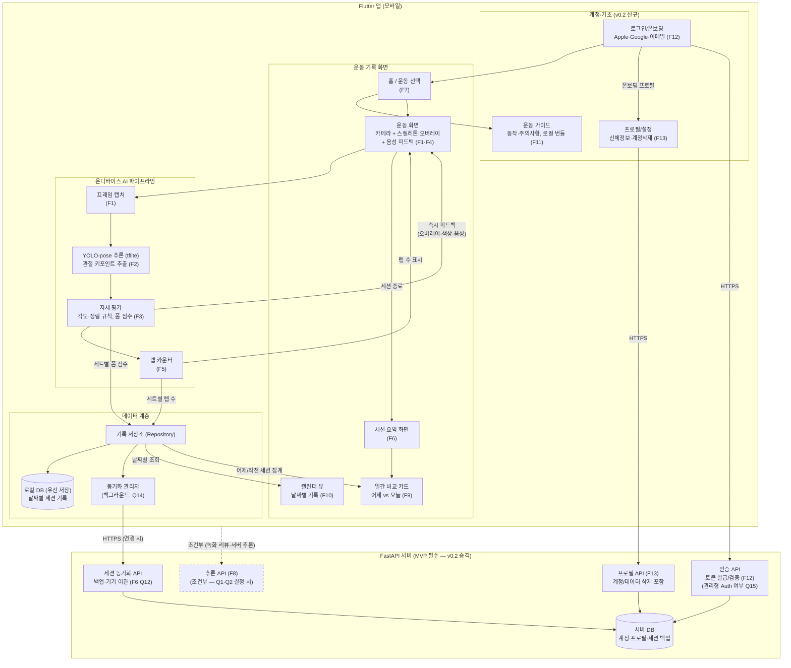
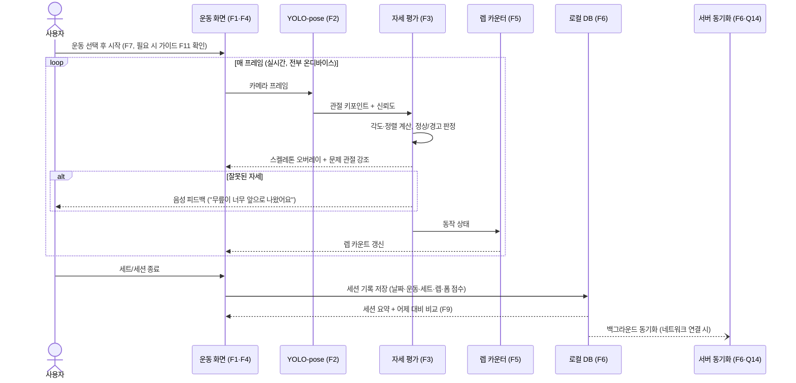
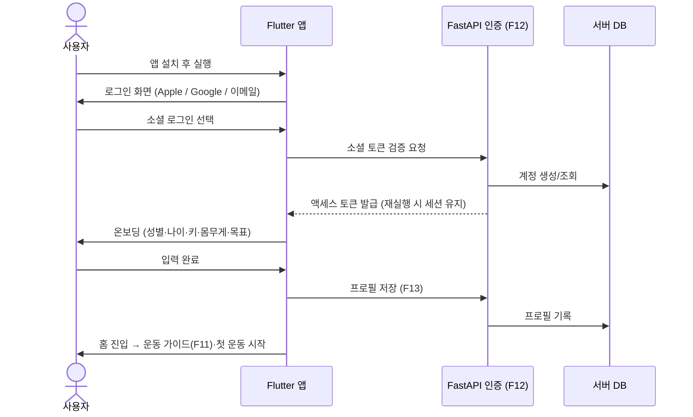
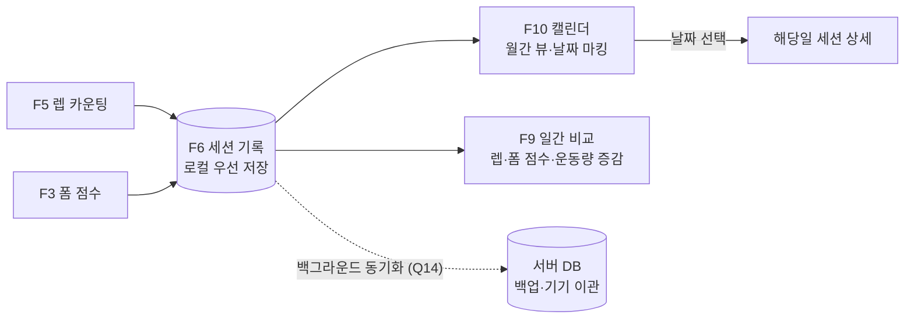
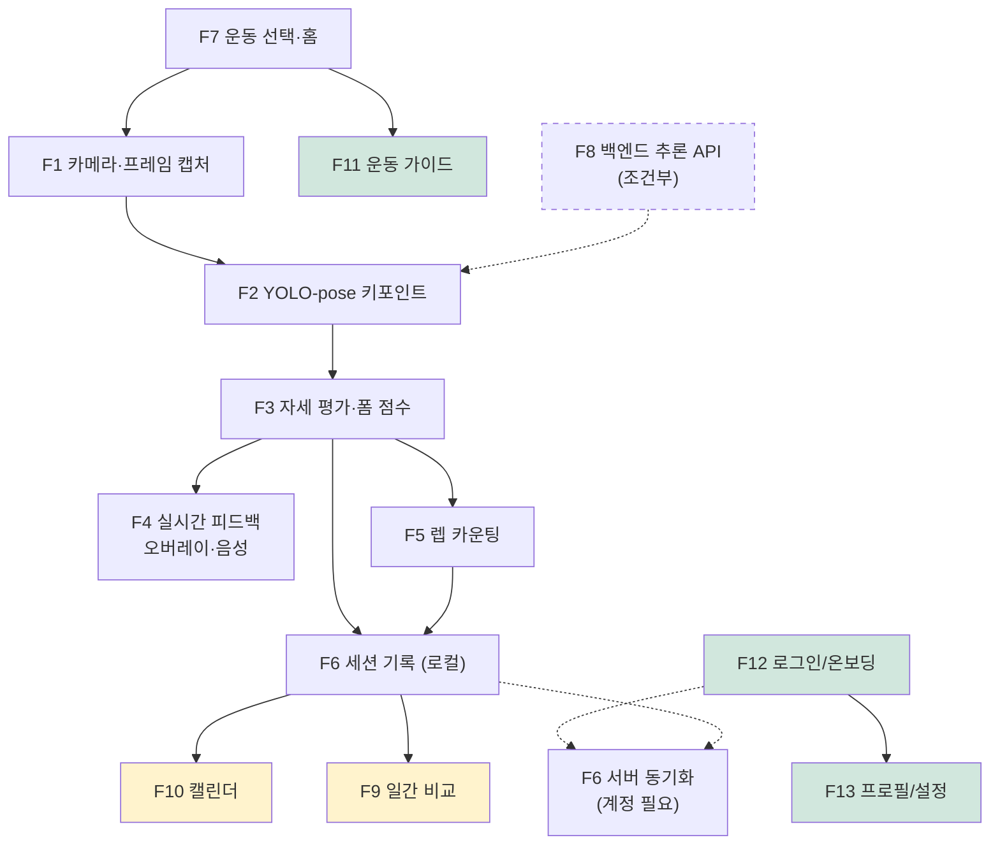

# 서비스 구조도 — YOLO-pose 헬스 자세 교정 앱

- 버전: v0.2 (2026-07-17)
- 기반 문서: [requirements.md](./requirements.md) v0.3 (F11~F13 추가, Q4 "계정 도입" 확정 반영)
- 전제: **Q1(추론 위치)·Q14(저장 전략)·Q15(인증 방식)는 미확정.** 아래 구조는 기획팀 권장안 — **온디바이스 추론 + 서버 인증/프로필(필수) + 세션 기록 로컬 우선·서버 동기화** — 를 기본으로 그렸다. v0.1의 "서버 없는 MVP"는 로그인 도입 확정으로 폐기됨.

---

## 1. 전체 서비스 구조

핵심 원칙 (v0.2):
- **실시간 루프(F1→F2→F3→F4)는 여전히 전부 기기 안에서 돈다** — 서버가 MVP에 들어왔지만 인증·프로필·동기화 용도일 뿐, 추론은 온디바이스 유지(Q1 권장안). **영상 원본은 서버로 전송하지 않는다** (프라이버시·대역폭·비용).
- **세션 기록은 로컬 우선 저장 + 백그라운드 서버 동기화** (Q14 권장안) — 헬스장 네트워크가 불안정해도 기록·조회 가능(Q10), 로그인 계정으로 백업·기기 이관(Q12 해소).
- **추론 API(F8)만 조건부로 남는다** — 녹화 정밀 리뷰(시나리오 B)나 서버 추론 채택 시에만.

## 2. 실시간 코칭 데이터 흐름 (시나리오 A)

## 3. 첫 사용(온보딩) 흐름 (시나리오 D — v0.2 신규)

## 4. 기록·비교·캘린더 데이터 흐름 (시나리오 C)

- F9와 F10은 **서로 의존하지 않는다** — 둘 다 F6에만 의존. (구현 순서 권고: F12 → F6 → F10 → F9)
- 세션의 소속 날짜는 **시작 시각의 기기 로컬 시간대 기준**으로 기록 시점에 확정 (requirements.md F10 수용 기준).

## 5. 기능 의존 그래프 (전체)

- 노란색: 사용자 추가 요청 (F9·F10) / 초록색: 기초 기능 표준화로 추가 (F11~F13, v0.2)
- 점선: 조건부 또는 계정 전제

## 6. 구조가 바뀌는 분기점 (열린 질문과의 연결)

| 결정 | 선택지 | 구조 변화 |
|---|---|---|
| ~~Q4 계정~~ | **도입으로 확정** | FastAPI 서버(인증·프로필·동기화) + 서버 DB가 MVP 필수 편입 — 본 문서 v0.2에 반영됨 |
| Q1 추론 위치 | 온디바이스 (권장) | 위 기본 구조 그대로 — 추론 API(F8) 불필요 |
| | 서버 추론 | F2·F3이 FastAPI로 이동, 실시간성 저하 — 시나리오 B 중심으로 재편 |
| | 하이브리드 | 파이프라인 2개 (실시간=온디바이스, 정밀 리뷰=서버) |
| Q2 녹화 리뷰 포함 | 포함 | F8 + 영상 업로드·분석 결과 화면 추가 |
| Q14 저장 전략 | 로컬 우선+동기화 (권장) | 위 기본 구조 그대로 — 오프라인 지원, Q12 해소 |
| | 서버 단독 | 로컬 DB·동기화 관리자 제거, 대신 오프라인 기록/조회 불가 (Q10 충돌) |
| Q15 인증 방식 | 관리형 Auth | 인증 API가 외부 서비스 연동 계층으로 축소, 개발 부담 감소 |
| | 자체 구현 | FastAPI에 토큰 발급·소셜 검증·세션 관리 전체 구현 |
